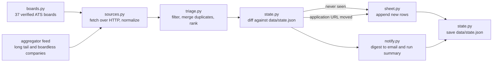

# job-radar

job-radar checks 38 company job boards plus one community aggregator feed three times a day and looks for Summer 2027 software engineering internships. Anything that matches your profile and that it has not seen before gets appended as a new row in a Google Sheet, and you get an email digest of the top five finds. It runs itself on a GitHub Actions cron, so after the one-time setup below there is nothing to babysit.

## Architecture

The pipeline is a straight line with no branches and no database. Each module does one job, and `cli.py` is the only thing that knows the order.



A few properties worth knowing up front:

- **One failing board never kills the run.** If a company changes its careers page or its ATS returns a 500, `sources.py` logs a warning, skips that board, and carries on with the rest. The aggregator feed is isolated the same way.
- **The state file is the memory.** `data/state.json` is committed to the repository, which is how the Action remembers what it saw yesterday without any external storage.
- **The sheet is append-only.** The pipeline adds rows and can correct a stale application URL, but it never deletes a row and never touches your `Status` column.

## Local quickstart

You need [uv](https://docs.astral.sh/uv/) and [Task](https://taskfile.dev/) installed. On macOS both are one Homebrew command: `brew install uv go-task`.

```bash
git clone https://github.com/manningwu07/job-radar.git
cd job-radar
task install
task dry-run
```

`task dry-run` needs **no credentials whatsoever**. There is no service account key to create, no sheet to make, and no password to generate before you run it. It fetches the real boards, runs the full filter and merge, prints the digest it would have emailed, and then writes nothing: no spreadsheet update, no email, and no change to `data/state.json`.

One thing to know about dry runs: they still **read** `data/state.json`, so the digest only lists postings that are not already recorded there. On a fresh clone the state file is empty and you will see everything. Once the Action has been running for a while, a dry run will legitimately print `No new jobs today.` because the state file already knows about every current posting. That is not a failure.

Run `task` on its own at any point to see every available task, and `task --summary <name>` for the long explanation of one of them.

When you are ready for the real thing, `task run` does the full pipeline. It expects the environment variables described in [GitHub Secrets](#github-secrets) to be present in your shell.

## What to expect from a run

The numbers are much larger going in than coming out. A live run in late July 2026 pulled **12,628 raw postings** and wrote about **70 rows**. That reduction is the entire point of the tool: almost everything on a company job board is not a Summer 2027 software engineering internship.

More importantly, **most of your target companies will report zero right now, and that is correct.** Summer 2027 recruiting has not opened yet as of July 2026. OpenAI, Anthropic and most of the tier one list have no 2027 internship requisitions posted at all, so their boards return nothing that survives the filter. If you see nothing from OpenAI, the tool is working and OpenAI simply has not posted yet.

This is precisely why the job runs on a cron instead of on demand. Boards open on no announced schedule, often quietly, and the postings that matter most fill quickly. The cron exists to catch each board the day it opens rather than whenever you happen to remember to look.

It runs three times a day rather than once because a single morning look is a poor sampling rate for something time-sensitive. A once-a-day 15:00 UTC run sampled just *before* the US business day, so a posting that went live at 9 AM Pacific waited 23 hours for the next scan.

The three runs are placed on the hours postings actually land instead of spread evenly around the clock. Across AMD's 630 US requisitions, 95% were posted between 06:00 and 17:00 Pacific, peaking at 08:00, while the entire 00:00-05:00 window held 1.6% between it. So the schedule is 09:00, 13:00 and 17:00 Pacific: fewer runs than an even six-hour spacing, and a shorter wait during the hours that matter, at most four hours from posting to digest through the working day. The long overnight gap is nearly empty, and anything posted in it is caught by the 09:00 run the same morning.

Only a run that actually finds something sends an email, so the extra runs do not mean extra mail.

### Where postings come from

| Platform | Boards | Examples |
| --- | --- | --- |
| Greenhouse | 22 | Anthropic, Databricks, Stripe, Anduril, Figma |
| Ashby | 8 | OpenAI, Linear, Snowflake, Cursor, Perplexity |
| Lever | 4 | Zoox, Palantir, Shield AI, Spotify |
| Workday | 2 | NVIDIA, Salesforce |
| SmartRecruiters | 1 | Wise |
| AMD | 1 | AMD |

Those 38 boards are split into three tiers: 19 tier one companies from your priority list, 12 tier two, and 7 tier three. The tier feeds ranking, so a tier one company sorts above an equally good posting elsewhere.

**Google, Tesla, Apple and Amazon are on the priority list but have no board entry**, because none of them exposes a usable public JSON job board. Google and Apple run bespoke career sites, and Amazon and Tesla use endpoints that are not stable enough to depend on. They are covered through the aggregator feed instead, which is a community-maintained Summer 2027 internship listing that already scrapes them. Postings for those four companies therefore arrive with `Source` set to `simplify`, and they do get ranked with their full priority because company names are canonicalized before ranking.

The two Workday boards are queried with a search term of `intern` and are paged to exhaustion, bounded by the `total` the API reports. NVIDIA returns about 960 matches and Salesforce about 770, so each takes roughly 40 to 50 requests at the API's maximum page size of 20; pages are fetched one at a time with a short delay, which keeps a full scan around a minute and well clear of any rate limit. This replaced a five-page ceiling that read only the first 100 results of each board, ordered by Workday's relevance sort rather than by date, which meant a large board could silently drop postings off the end.

**AMD has its own fetcher** rather than arriving through the aggregator. AMD's career site exposes a public JSON API with true posting timestamps, and it is queried on the board's own early-career category, which returns about 40 postings instead of the ~1200 on the whole board. Because that category label is AMD's to rename, a query that matches nothing falls back to paging the unfiltered board newest-first, stopping once postings are more than 30 days old.

Sourcing AMD directly matters for speed, not just tidiness. When AMD opened its 2027 internships at 23:28 UTC on 20 August 2026, the aggregator did not pick them up until 15:41 UTC the next day, which was 41 minutes after that morning's scan had already run, so the digest did not go out until the morning of 22 August: roughly 40 hours, of which about 16 were the aggregator's lag and the rest were the once-a-day schedule. Reading the board directly removes the first delay and the six-hour cadence caps the second.

## Google Sheets setup

This is the longest part of the setup, and it is a one-time cost. Follow it in order.

1. Go to the [Google Cloud Console](https://console.cloud.google.com/) and sign in with the Google account that owns the spreadsheet you want to use.
2. Create a new project. Click the project dropdown in the top bar, choose **New Project**, name it something like `job-radar`, and click **Create**. Wait for the notification that it is ready, then make sure that project is selected in the top bar.
3. Enable the Google Sheets API. Navigate to **APIs and Services**, then **Library**, search for `Google Sheets API`, open it, and click **Enable**. If you skip this, authentication will succeed and then every read and write will fail with a message saying the API has not been used in the project before.
4. Create a service account. Go to **APIs and Services**, then **Credentials**, click **Create Credentials**, and choose **Service account**. Give it a name such as `job-radar-writer`. You can skip the optional steps that offer to grant it project roles and grant users access to it, because this account does not need any Google Cloud IAM permissions. Click **Done**.
5. Create and download a JSON key. From the **Credentials** page, click the service account you just made, open the **Keys** tab, click **Add Key**, then **Create new key**, select **JSON**, and click **Create**. Your browser downloads a `.json` file. This file is the credential. Keep it out of the repository. `.gitignore` already blocks any filename containing `service-account` as well as `.env`, but the safest habit is to leave the download in your home directory and never copy it into the project.
6. Copy the service account's email address. It is on the same **Credentials** page and looks like `job-radar-writer@your-project-id.iam.gserviceaccount.com`. It is also the `client_email` field inside the JSON key file.
7. Create the spreadsheet you want to fill, open it, click **Share**, paste that service account email address into the invite box, set its role to **Editor**, and send the invitation. There is no inbox on the other end, so ignore any warning about notifying an external address.

   **This is the step everybody forgets.** A service account is a separate identity from you, so owning the spreadsheet yourself grants it nothing. If you skip this share, the credentials are valid, the API is enabled, and the run still fails: you get a `403` with `PERMISSION_DENIED` or a gspread `SpreadsheetNotFound` error, and the CLI exits with code 3. If you see either of those, come back to this step before you debug anything else.

8. Get the spreadsheet ID out of the URL. With the sheet open, the address bar reads `https://docs.google.com/spreadsheets/d/SPREADSHEET_ID/edit#gid=0`. The ID is the long segment between `/d/` and `/edit`, roughly 44 characters of letters, digits, hyphens, and underscores. Copy that segment only. Do not include `/d/`, the `/edit` suffix, or the `#gid=0` fragment.

You now have the two values you need from Google: the spreadsheet ID from step 8, and the entire contents of the JSON key file from step 5.

The pipeline writes to the **first worksheet** of that spreadsheet, and it will only create the header row if row 1 is completely empty. If row 1 has content that does not exactly match the twelve expected headers, the run refuses to touch the sheet and fails with an error naming what it found. Start with a blank spreadsheet and let the first run set up the header.

## Gmail app password setup

The digest email is sent through Gmail specifically, over SMTP with SSL to `smtp.gmail.com`. The host is not configurable, so the sending account has to be a Gmail or Google Workspace account. Gmail refuses plain-password logins from scripts, so you need an app password.

1. Turn on 2-Step Verification for the Google account, at [myaccount.google.com/security](https://myaccount.google.com/security). App passwords do not exist as an option until 2FA is enabled, and there is no way around this.
2. Go to [myaccount.google.com/apppasswords](https://myaccount.google.com/apppasswords), enter a name such as `job-radar`, and click **Create**.
3. Google shows you a 16-character password in four blocks of four. Copy it. You cannot view it again after closing the dialog, though you can always delete it and make a new one. Spaces in the displayed value are for readability only, and it works with or without them.

Your **normal account password will not work here**, and neither will an account without 2FA. If you try either, the run logs an SMTP error reading `535 Username and Password not accepted`. Note that a failed email is treated as non-fatal on purpose: the spreadsheet still gets updated and the run still succeeds, so a broken app password costs you the notification and nothing else.

## GitHub Secrets

Set all five in the repository under **Settings**, then **Secrets and variables**, then **Actions**, then **New repository secret**. The names below are the only names the code reads. There are no aliases and no fallbacks, so a typo behaves exactly like a missing value.

| Secret | Example value shape | What breaks if it is missing |
| --- | --- | --- |
| `JOB_RADAR_SHEET_ID` | The 44-character ID from step 8 above, such as `1AbC...xYz`, with no slashes | The run cannot tell which spreadsheet to open. It logs a configuration error and exits with code 2 before fetching anything. |
| `GOOGLE_SERVICE_ACCOUNT_JSON` | The whole JSON key file pasted verbatim, starting with `{"type": "service_account", ...` and including the newline escapes inside `private_key` | No authentication is possible. The run exits with code 2. If the value is present but truncated or reformatted, you instead get a JSON parse or invalid-key error and exit code 3. |
| `SMTP_USER` | Your full Gmail address, such as `you@gmail.com` | No digest email is sent. The scan itself still runs and the sheet is still updated. |
| `SMTP_PASSWORD` | The 16-character app password from the section above, not your account password | Same as above: SMTP login fails, the error is logged, and the run still succeeds. |
| `NOTIFY_EMAIL` | The address that should receive the digest, which can be the same as `SMTP_USER` | There is no recipient, so no digest is sent. The sheet is still updated. |

Only the first two are required. Missing email settings produce a warning and are skipped, because the sheet is the product and the email is a convenience. The same five names work as ordinary environment variables when you run locally with `task run`.

## What gets filtered out

A posting has to clear every one of these gates to reach your sheet. All of them read the job title only, except where noted.

1. **It must look like an internship.** The title has to contain one of `intern`, `internship`, `co-op`, `student`, `university`, `undergraduate`, `apprentice` or `early career`.
2. **It must match one of your eight interest areas**, which are software engineering, machine learning, backend infrastructure, distributed systems, platform engineering, AI infrastructure, robotics software, and research engineering. A title that matches none of them is dropped, so a generic `Engineering Intern` with no further detail does not make it through.
3. **Wrong level is rejected.** Anything reading new grad, recent graduate, senior, staff, principal, distinguished, experienced, lead, manager or director is dropped.
4. **Wrong function is rejected.** Product and program management, data and business analytics, IT support, QA and test engineering, and quantitative research are all dropped. Trading roles are dropped unless the title also says software engineer.
5. **Narrowly scoped roles are rejected.** A posting scoped only to frontend, mobile or security is dropped, but it survives if the title also mentions something broader such as full stack, backend, infrastructure, platform, distributed, systems, machine learning, compiler or kernel.
6. **Stale postings are rejected.** Anything posted more than **180 days** before the run is dropped. Internship recruiting runs on an annual cycle, so a requisition that has been open for a year is not something you can act on. Postings with no date at all are kept, because most ATS listings do not publish one and dropping them would gut the results.
7. **Non-Summer terms are rejected.** Fall, Winter and Spring internships are dropped. Three independent signals are read and any one of them can reject a posting: the season named in the title, a season sitting next to a year in the application URL slug, and the season field the aggregator supplies. Postings that state no season at all are kept, for the same reason as undated ones.

The target year is computed from the date of the run rather than hardcoded, and the cycle rolls over in June. A run in July 2026 targets Summer 2027, and so does a run in January 2027. This means a posting titled `Summer 2026 Software Engineer Intern` is rejected as being for a past cycle, and you will never have to edit a year in the source.

The URL is only inspected for a season when a year sits right next to it, which is what keeps a Lever board slug like `jobs.lever.co/spring-health/...` from being mistaken for a Spring internship.

## The sheet layout

On its first run against an empty sheet the pipeline writes this header row, then appends one row per job.

| Column | Contents |
| --- | --- |
| Company | Canonical company name. Aliases and legal suffixes are resolved first, so `Palantir Technologies` and `Palantir` both land as `Palantir`. |
| Role | The job title. When several postings merge into one row, the most descriptive of their titles is shown. |
| Location | Every city the merged postings covered, most preferred first, capped at three with a `+N more` count. |
| Remote? | `Yes` or `No`. Yes if any of the merged postings was remote. |
| Posting Date | ISO date, the most recent across the merged postings. Blank if none of them published a date. |
| Date Found | ISO date, in US Pacific time, when this posting was first seen. |
| Source | Where the posting was discovered. One of `greenhouse`, `lever`, `ashby`, `smartrecruiters`, `workday` or `simplify`. |
| Application URL | The best link to apply, preferring a first-party ATS link over an aggregator one. |
| Careers URL | The company's careers page. |
| Platform | Which ATS actually hosts the application. |
| Notes | Sponsorship and term details, when the aggregator supplied them. Board-sourced rows leave this blank. |
| Status | Your application status. |

### Source and Platform are not the same thing

These two columns look redundant and are not. `Source` is **where job-radar found the posting**. `Platform` is **which applicant tracking system hosts the application form**, determined from the host of the application URL.

So a row reading `Source: simplify` with `Platform: Greenhouse` is correct and common. It means the aggregator feed is where the posting was discovered, and the application itself lives on Greenhouse. Rows where a company runs its own career site correctly show `Platform: Other`, because the URL host matches no known ATS.

### Status is yours

Every new row arrives with `Not Applied`, and from that moment the pipeline never reads or rewrites the column. Change it to `Applied`, `Interviewing`, `Rejected`, or anything else you like, and it will survive every future run. This is enforced by a test that performs a URL update against a hand-edited row and asserts that the **only** cell in the sheet that changed is the Application URL cell, with `Status` and `Notes` still holding their edited values.

The Application URL is the one cell the pipeline will rewrite on an existing row, and only when a posting moves to a new link.

Two cautions about editing by hand. Do not edit the `Company` or `Role` cells, because the pipeline rebuilds each row's identity from those two columns in order to find the row again. Change them and the posting looks new, which gets you a duplicate row. And do not add extra columns of your own, because the run compares row 1 against the twelve expected headers and refuses to proceed if it does not match exactly. Sorting, filtering and freezing the header are all safe.

## How dedupe works

A job's identity is **company plus role**, and nothing else. Both are lowercased with whitespace collapsed, the company name is canonicalized, the role title has its date decoration stripped, and the pair is hashed.

Location and application URL are both deliberately excluded, and the reasoning is worth spelling out because it is not obvious:

- **Employers post one requisition per city.** Palantir's `Software Engineer Intern` arrives as four separate Lever postings, one each for Palo Alto, New York, Washington DC and Denver, each with its own URL. It is one internship and one application. Including location in the key produced four rows for it, and Palantir together with Etched accounted for roughly 22 of 125 rows in an earlier build.
- **The same requisition reaches us from several sources under different URL forms.** Anduril requisition `5148079007` came in under both `boards.greenhouse.io` and `job-boards.greenhouse.io`. One posting arrived twice differing only by an `?embed=true` suffix. Appian requisition `8041237` came from both `job-boards.greenhouse.io` and the company's own `careers.appian.com`. Keying on the URL split every one of those into duplicate rows.
- **Excluding the URL is also what makes a moved posting updatable.** Because the URL is not part of the identity, a posting that changes links is recognized as the same job and its existing row gets a new URL, instead of appearing as a brand new find.

The role title is also stripped of date decoration before hashing, specifically a four-digit year and an optional season word in front of it. That is what lets `2027 Software Engineer Intern` and `Software Engineer Intern` be recognized as one job, which is exactly how Greenhouse and the aggregator each titled that same Anduril requisition. Note that a season with no year attached is not stripped, so `Summer Software Engineer Intern` keeps its wording.

### Duplicates are merged, not discarded

When several postings share a key they are combined into one row that takes the best value for each field, rather than one of them winning and the rest being thrown away:

- **Locations** are unioned across the whole group, ordered by your geographic preference so the cities you care about appear first, then capped at three with a `+N more` count for the rest. Five Palantir cities render as `Palo Alto, CA; Seattle, WA; New York, NY; +2 more`. Because each source's cities are themselves capped before merging, this cell can understate how many cities a single posting listed, so open the application URL if you need the authoritative list.
- **Posting Date** takes the most recent date in the group.
- **Remote?** is `Yes` if any posting in the group was remote.
- **Application URL** prefers a first-party ATS link over an aggregator link, then a clean URL over one carrying query parameters, then the shortest form.
- **Role** takes the most descriptive title in the group.
- **Source, Platform, Careers URL and Notes** all come from whichever posting supplied the winning application URL, so the row stays internally consistent rather than mixing fields from different records.

### Resetting the memory

`data/state.json` maps each key to what was last seen for it. Every run diffs the freshly merged postings against that file. Keys that are absent are new, and get appended to the sheet and into the digest. Keys that are present with a different application URL count as changed, so that one cell is updated in place.

To make postings look new again, edit `data/state.json`. Delete the individual entries you want back from the `jobs` object, or empty it entirely to reset everything:

```json
{
  "version": 1,
  "jobs": {}
}
```

Commit and push that change and the next run re-reports everything, appending fresh duplicate rows to the sheet. Delete the rows you do not want from the spreadsheet by hand, since the pipeline will not do it for you.

## Adding a company

Companies live in the `BOARDS` tuple in `src/radar/boards.py`. Add one `Board` entry and you are done, because everything downstream is driven off that tuple.

A `Board` has five fields:

| Field | Meaning |
| --- | --- |
| `company` | Display name, used in the sheet and the digest |
| `platform` | A `Platform` enum member: `GREENHOUSE`, `LEVER`, `ASHBY`, `SMARTRECRUITERS` or `WORKDAY` |
| `token` | The board identifier the ATS uses for that company, described below |
| `careers_url` | The human-facing careers page, copied into the sheet |
| `tier` | `1` for a company on your priority list, `2` for notable, `3` for long tail |

The `token` is almost always sitting in plain sight in the company's careers page URL. Open the careers page, follow any redirect, then read off the path segment:

| ATS | URL you will land on | Token |
| --- | --- | --- |
| Greenhouse | `boards.greenhouse.io/stripe` or `job-boards.greenhouse.io/stripe` | `stripe` |
| Lever | `jobs.lever.co/palantir` | `palantir` |
| Ashby | `jobs.ashbyhq.com/openai` | `openai` |
| SmartRecruiters | `careers.smartrecruiters.com/Wise` | `Wise` |
| Workday | `nvidia.wd5.myworkdayjobs.com/NVIDIAExternalCareerSite` | `nvidia.wd5.myworkdayjobs.com\|nvidia\|NVIDIAExternalCareerSite` |

Tokens are case-sensitive on some platforms, so copy them exactly as they appear rather than lowercasing them. Workday is the awkward one: it needs three pieces joined by pipe characters, and they are the **full hostname**, then the **tenant**, then the **site name**. The hostname already includes the tenant as its first label, so the tenant is repeated in the middle position. Both shipped Workday entries follow that shape, the other being `salesforce.wd12.myworkdayjobs.com|salesforce|External_Career_Site`. A token with anything other than three non-empty pieces makes that one board fail with a warning and skips it.

If a company's name differs between its board and the aggregator, add the variant to `COMPANY_ALIASES` in the same file so both spellings collapse to one row and rank correctly.

After adding a board, run `task dry-run` and check that the company appears in the output. If it does not, either the token is wrong, in which case a warning in the log will name the board that failed, or that company simply has no matching internships posted yet.

## Troubleshooting

**The Action fails immediately with exit code 2 and a configuration error.**
`JOB_RADAR_SHEET_ID` or `GOOGLE_SERVICE_ACCOUNT_JSON` is missing or misnamed. The names are case-sensitive and there are no aliases, so `GOOGLE_SERVICE_ACCOUNT` will not stand in for `GOOGLE_SERVICE_ACCOUNT_JSON`. Compare your secrets against the table above character by character. GitHub does not let you view a secret's value after saving, so if you suspect a bad paste, delete it and set it again.

**Exit code 3, or a `403 PERMISSION_DENIED`, or `SpreadsheetNotFound`.**
Almost always the missed share from step 7 of the Google setup. Open the spreadsheet, click **Share**, and confirm the service account's `client_email` is listed as an **Editor**. If it is there and you still fail, check that the Google Sheets API is actually enabled in the project from step 3, and that `JOB_RADAR_SHEET_ID` holds only the ID and not the full URL.

**The run fails saying the header row does not match the expected schema.**
Row 1 of the first worksheet has content that is not exactly the twelve expected headers, and the pipeline will not overwrite whatever you have there. This usually means you added a column of your own or renamed one. Restore row 1 to the twelve headers in the table above, or clear row 1 entirely and let the next run rewrite it.

**Every target company reports zero.**
Expected in the middle of the year. Summer 2027 postings largely do not exist yet, and the daily cron is there to catch them appearing. Confirm the machinery is alive by checking the run log for the triage line, which reports how many raw postings were fetched. A number in the thousands with a low row count means fetching works and there is genuinely nothing to report yet.

**The sheet updates but no email arrives.**
Email is best-effort by design and never fails the run, so look in the step log for the SMTP error rather than expecting a red X. A `535 Username and Password not accepted` means you used your account password instead of a 16-character app password, or 2FA is off on the account. A non-Gmail sending account will also fail, since the SMTP host is fixed to Gmail. Also confirm all three of `SMTP_USER`, `SMTP_PASSWORD` and `NOTIFY_EMAIL` are set, because a missing one is logged as a warning and skipped rather than failing loudly.

**One company that used to appear has stopped.**
Search the run log for a warning naming that board. A single board failing is logged and skipped on purpose so one broken ATS cannot cost you the whole day's scan. The usual cause is that the company migrated ATS providers or renamed its board, so re-derive the token from its careers page URL using the table above.

**The digest says "No new jobs today" every single day.**
Usually correct: everything currently posted is already in your sheet, and dedupe is doing its job. Remember that a local `task dry-run` reads the same state file, so it will agree. To see the full unfiltered picture instead, temporarily point the run at a throwaway state file with `uv run job-radar --dry-run --state /tmp/empty.json`, which treats every posting as new without disturbing your real state.

**Duplicate rows appeared for a job you already had.**
Something changed the identity of the row. Check whether the `Company` or `Role` cell was hand-edited, since those two columns are what the pipeline uses to find an existing row. Delete the duplicate and restore the original text in those cells.

**The runs happen an hour early in the winter.**
Expected. GitHub schedules cron in UTC and does not observe daylight saving time, so the fixed `4 16,20,0 * * *` schedule lands at 08:00, 12:00 and 16:00 Pacific from November to March instead of 09:00, 13:00 and 17:00. Both sets sit inside the active posting window, so no change is needed.

**A run starts late, sometimes by an hour or more.**
Expected, and partly mitigated. Scheduled Actions runs are queued rather than guaranteed, and the top of the hour is the most contended slot; this workflow was previously observed starting anywhere from 16 minutes to two hours after its `0 15` schedule. The cron is now offset to `:04` to sit outside that spike. Runs can still be delayed or dropped under heavy load, which is another reason three looks a day beats one.

**A quiet run sends no email.**
Expected. A run that appends no new rows and refreshes no URLs writes its digest to the Actions step summary and skips the email, so four runs a day do not fill your inbox with "no new jobs".

---

> *This document was generated with [Zada](https://git.zooxlabs.com/awallar/zada)*
